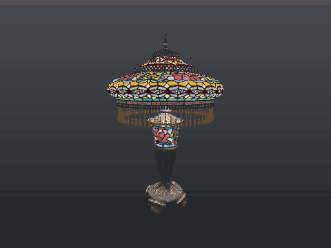
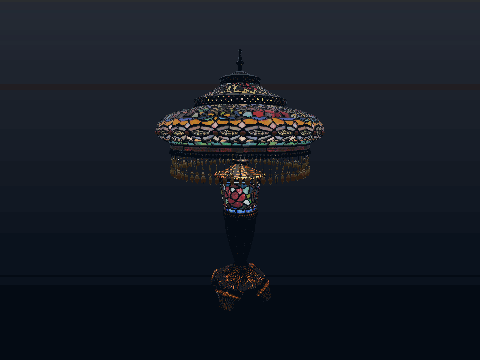
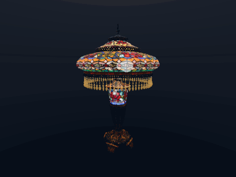
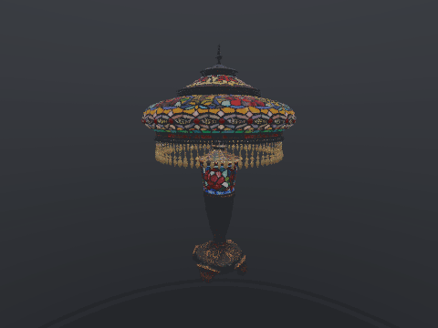
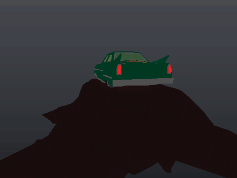
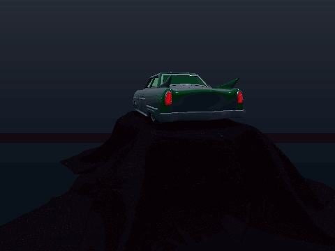
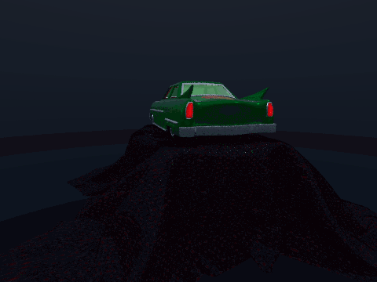
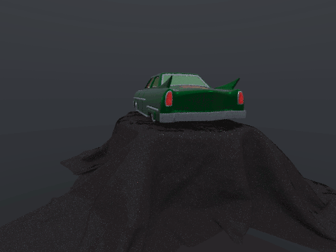

# LightingShowcase Avalonia Composer

Scene composer and renderer (Avalonia 12.1, .NET 10) for glTF/GLB, FBX, OBJ, 3DS, PLY, STL, and PropXML: procedural primitives, material and light editing, four render backends, UI or headless.

## Render gallery

Official [KhronosGroup glTF sample models](https://github.com/KhronosGroup/glTF-Sample-Models) samples in `models/`, headless at 480×360 with 4 samples and 2 bounces (zoom 1.6 lamp, 2.6 car). ▶ 36-frame GIFs at 12 fps, one per backend, playing automatically.

### StainedGlassLamp — 35,132 triangles

| ▶ raster | ▶ Vulkan raster |
|---|---|
|  |  |
| ▶ Vulkan compute | ▶ CPU |
|  |  |

### ToyCar — 108,936 triangles

| ▶ raster | ▶ Vulkan raster |
|---|---|
|  |  |
| ▶ Vulkan compute | ▶ CPU |
|  |  |

Model licenses: StainedGlassLamp under CC-BY 4.0 (Wayfair); ToyCar public domain (CC0).

Texture licenses: the `textures/` material library ships CC0 1K maps from Poly Haven (brick, concrete, wood, marble, denim, metal); see `textures/TEXTURES_LICENSES.md` for per-file credits.

### Render times

AMD Ryzen 3 7320U (8 threads), AMD Radeon integrated graphics, 8 GB RAM, Windows 11, .NET 10. Steady-state time per frame (median; first frame excluded as one-time scene upload).

| Model | raster | raster-vulkan | vulkan | cpu |
|---|---|---|---|---|
| StainedGlassLamp | 217 ms | 7.9 ms | 665 ms | 1.3 s |
| ToyCar | 851 ms | 9.3 ms | 1.3 s | 4.3 s |

```bash
./run.sh render ./models/StainedGlassLamp/StainedGlassLamp.gltf --renderer raster-vulkan \
  --output ./screenshots/StainedGlassLamp-raster-vulkan.gif \
  --width 480 --height 360 --samples 4 --bounces 2 --zoom 1.6 --frames 36 --fps 12
```

Headless default lights are seated relative to the camera so they always cover the visible area. Override them with repeatable `--light "kind=point;position=3,4,-2;color=1,1,1;intensity=5"` (kind, direction, range, cones, shadows, id, enabled also supported).

### glTF feature support

The importer reads glTF 2.0 `.gltf`/`.glb`: triangle primitives (`POSITION`, `NORMAL`, `TEXCOORD_n`, `COLOR_0`), node hierarchy with matrix or TRS transforms, core PBR materials, `KHR_materials_transmission`, `_ior`, `_volume`, `_clearcoat`, `KHR_texture_transform`, and `KHR_lights_punctual`. Not supported: skins, animations, morph targets, cameras, Draco/meshopt, sheen/specular/anisotropy/iridescence.

| Feature | raster | raster-vulkan | vulkan | cpu |
|---|---|---|---|---|
| Base color, metallic/roughness, emissive + textures | Yes | Yes | Yes | Yes |
| Normal maps, occlusion | No | Yes | Yes | Yes |
| Alpha blend / mask, double-sided | Discard only | Yes | Mask only | Blend approx |
| Transmission | No | Refraction | Pass-through | Blend approx |
| Clearcoat, IOR, volume | No | Yes | No | No |
| Texture transform + wrap, vertex colors, lights | Yes | Yes | Partial | Yes |

## Build and run

Requires the .NET 10 SDK and, for Vulkan modes, a Vulkan-capable driver. Open `LightingShowcase.Composer.sln` in VS 2022 17.8+/Rider, or `dotnet build`. Run `./run.sh`; headless verbs: `render`, `export`, `formats`, `--help`.

## Controls

`1/2/3/4` selection modes; `G/R/S` gizmos; drag axes or handles (Shift precise, Ctrl snap); right-drag orbit, middle-drag pan, wheel zoom; `F` frame, `Ctrl+D` duplicate, `Ctrl+G` group, `Delete`, `Ctrl+Z/Y` undo/redo; right-click a face for Extrude/Inset; Ctrl-click multi-selects.

## Docs

[Primitives](docs/PARAMETERIZED_PRIMITIVES.md) · [Materials](docs/MATERIAL_EDITING.md) · [Lighting](docs/LIGHTING_EDITOR.md) · [Mesh editing](docs/MESH_EDITING.md) · [Transform preview](docs/GIZMO_TRANSFORM_PREVIEW.md)
