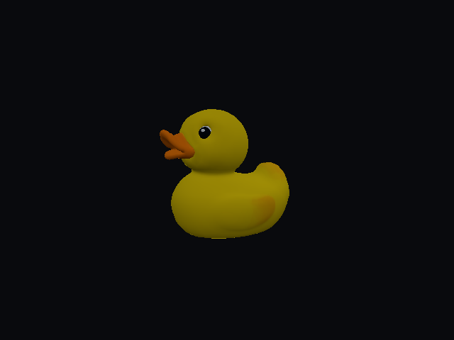
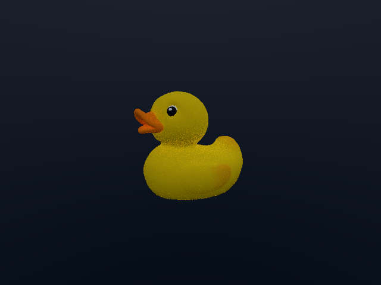
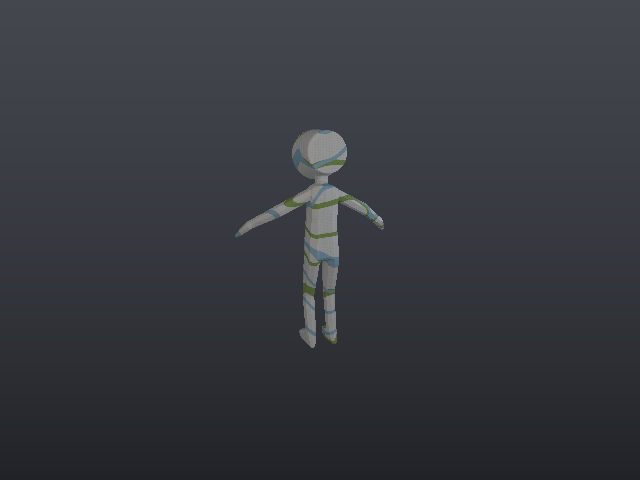
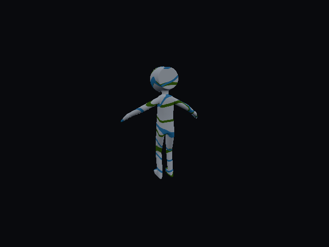
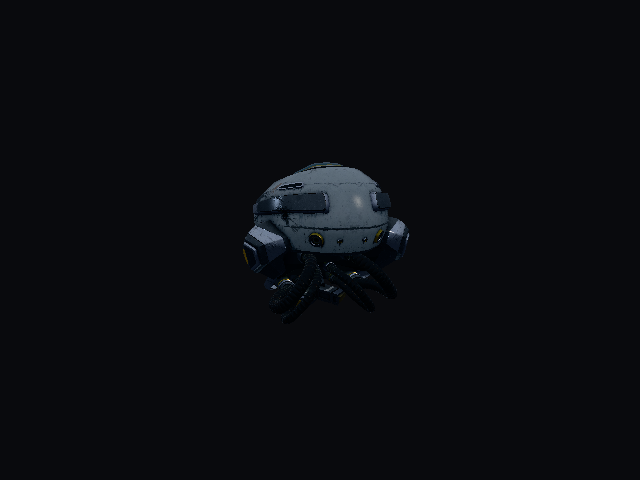
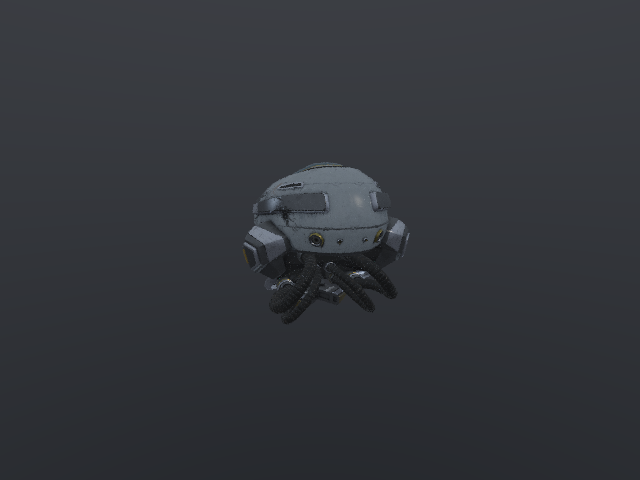

# LightingShowcase Avalonia Composer

A standalone, platform-neutral scene composer and renderer built with Avalonia 12.1 and .NET 10. Open or insert glTF/GLB, FBX, OBJ, 3DS, PLY, STL, and PropXML assets, add procedural primitives, edit materials and lights, and preview with software raster, Vulkan raster, Vulkan compute, or CPU ray rendering — in the UI or headless.

## Render gallery

Official [KhronosGroup glTF sample models](https://github.com/KhronosGroup/glTF-Sample-Models) in `models/`, rendered headless at 640×480 with 4 samples and 2 bounces.

### Duck — 4,212 triangles

| raster | raster-vulkan |
|---|---|
|  |  |
| vulkan | cpu |
|  |  |

### CesiumMan — 4,672 triangles, bind pose

| raster | raster-vulkan |
|---|---|
|  |  |
| vulkan | cpu |
|  |  |

### DamagedHelmet — 15,452 triangles, full PBR

| raster | raster-vulkan |
|---|---|
|  |  |
| vulkan | cpu |
|  |  |

Model licenses: Duck under SCEA Shared Source 1.0; DamagedHelmet under CC Attribution-NonCommercial; CesiumMan under CC-BY 4.0.

### Render times

AMD Ryzen 3 7320U (8 threads), AMD Radeon integrated graphics, 8 GB RAM, Windows 11, .NET 10. End to end per render: startup, import, GPU setup, and frame.

| Model | Triangles | raster | raster-vulkan | vulkan | cpu |
|---|---|---|---|---|---|
| Duck | 4,212 | 0.4 s | 1.7 s | 3.6 s | 1.0 s |
| CesiumMan | 4,672 | 0.4 s | 1.7 s | 3.7 s | 0.7 s |
| DamagedHelmet | 15,452 | 1.8 s | 4.1 s | 6.1 s | 2.3 s |

### glTF feature support

The importer reads glTF 2.0 `.gltf`/`.glb`: triangle primitives (`POSITION`, `NORMAL`, `TEXCOORD_n`, `COLOR_0`), node hierarchy with matrix or TRS transforms, core PBR materials, `KHR_materials_transmission`, `_ior`, `_volume`, `_clearcoat`, `KHR_texture_transform`, and `KHR_lights_punctual`. Not supported: skins, animations, morph targets, cameras, Draco/meshopt, sheen/specular/anisotropy/iridescence.

| Feature | raster | raster-vulkan | vulkan | cpu |
|---|---|---|---|---|
| Base color, metallic/roughness, emissive + textures | Yes | Yes | Yes | Yes |
| Normal maps, occlusion | No | Yes | Yes | Yes |
| Alpha blend / mask, double-sided | Discard only | Yes | Mask only | Blend approx |
| Transmission | No | Refraction | Pass-through | Blend approx |
| Clearcoat, IOR, volume | No | Yes | No | No |
| Texture transform + wrap, vertex colors, lights | Yes | Yes | Partial | Yes |

## Build and run

Requires the .NET 10 SDK and, for Vulkan modes, a Vulkan-capable driver. Open `LightingShowcase.Composer.sln` in Visual Studio 2022 17.8+, Rider, or build with `dotnet build`. Run with `./run.sh`, optionally passing a scene (`./run.sh compose ./scene.glb`). Headless: `./run.sh render ./scene.glb --renderer raster-vulkan --output ./out.png` (`render`, `export`, `formats`, `--help`).

## Controls

`1/2/3/4` selection modes; `G/R/S` gizmos; drag axes or handles (Shift precise, Ctrl snap); right-drag orbit, middle-drag pan, wheel zoom; `F` frame, `Ctrl+D` duplicate, `Ctrl+G` group, `Delete`, `Ctrl+Z/Y` undo/redo; right-click a face for Extrude/Inset; Ctrl-click multi-selects.

## Docs

[Primitives](PARAMETERIZED_PRIMITIVES.md) · [Materials](MATERIAL_EDITING.md) · [Lighting](LIGHTING_EDITOR.md) · [Mesh editing](MESH_EDITING.md) · [Transform preview](GIZMO_TRANSFORM_PREVIEW.md)
